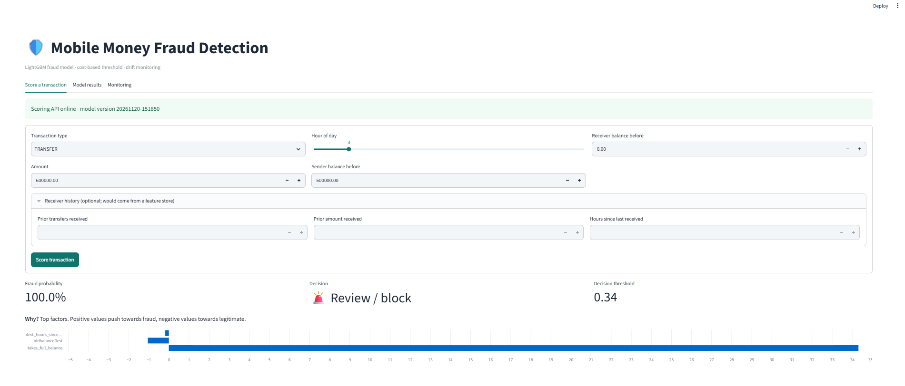
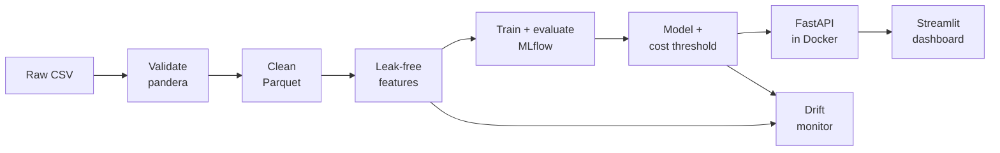

# 🛡️ Mobile Money Fraud Detection

[](https://github.com/Getrudetrudy01/mobile-money-fraud-detection/actions/workflows/ci.yml)


An end-to-end machine learning system that flags fraudulent mobile money transactions in real time. It goes from raw data to a monitored, containerised scoring service, with an analyst dashboard on top.



I work in operations at a Bank of Ghana-licensed payment service provider, and I built this the way I'd want a fraud system at work to behave:
- alert thresholds set by **business cost**, not by default
- every alert **explained** to the analyst reviewing it
- **data health checked before the model is blamed**
- an honest account of what the scores do and don't prove

---

## At a glance

| | |
|---|---|
| **Data** | 6.36M simulated mobile money transactions (PaySim); 0.13% fraud |
| **Best model** | LightGBM: test PR-AUC **0.9995**, catching 99.7% of fraud with zero false alarms |
| **Honest estimate** | **0.84 PR-AUC / 67% recall at 0.1% false alarms** once PaySim's built-in fraud shortcut is removed |
| **Serving** | FastAPI + Docker, with per-prediction explanations (SHAP) |
| **Dashboard** | Streamlit: live scoring, model comparison, monitoring |
| **Monitoring** | PSI drift, alert rate and volume checks, with a recommended action |
| **Quality** | 21 tests, Ruff linting, GitHub Actions CI on every push |

---

## Architecture



Each stage is one command (`make data`, `make features`, `make train`, …). Each stage reads from one data layer and writes to the next, and raw data is never modified. The dashboard calls the API instead of loading the model itself, so every app uses the same model.

---

## Results

**Test set**, using a time-based split: trained on the earliest hours and tested on the latest, never on data from the future.

| Model | PR-AUC | ROC-AUC | Recall @ 0.1% FPR | Fraud value missed |
|---|---|---|---|---|
| Rule: flag if amount = full balance | 0.972 | 0.986 | 97.2% | ~997M |
| Logistic regression | 0.993 | 0.998 | 99.1% | ~67M |
| **LightGBM** | **0.9995** | 0.9995 | **99.5%** | **~26M** |
| LightGBM, *without* drain features (ablation) | 0.845 | 0.990 | 67.4% | n/a |

### What these numbers really mean

**1. The top score mostly reflects how the simulator works.** One feature, `takes_full_balance`, provides **95%** of the model's gain. PaySim generates fraud by emptying the victim's account, and the model learned that rule. A near-perfect score here is a ceiling, not a real-world estimate.

**2. The ablation is the honest number.** With the drain features removed, the model still catches two-thirds of fraud at a strict false-alarm rate. It does this using the amount, balances, time of day and the receiving account's history.

**3. ROC-AUC hides the drop.** It stayed at **0.99** for both models. Only PR-AUC showed the real difference, which is why PR-AUC is the main metric for rare events like fraud.

**4. Counting money tells a different story from counting cases.** The one-line rule catches 97% of fraud *cases* but misses **~997M** in fraud *value*, about 38× more than LightGBM. PaySim caps single transfers, so large accounts are emptied in several chunks. None of the chunks equals the full balance, so the rule misses exactly the biggest frauds.

---

## Key design decisions

### No data leakage
A real-time model scores a transaction **before** it's approved, so features may only use information available at that moment.
- Post-transaction balances are excluded, and the API doesn't even accept them.
- "Drains the account" is rebuilt from pre-transaction data: `amount / oldbalanceOrg`.
- Receiving-account history uses **only earlier hours**, and a unit test enforces this.

### Thresholds set by cost
The model outputs a probability, but operations needs a yes/no answer. The threshold minimises total cost:
- **a missed fraud** costs the transaction amount
- **a false alarm** costs a fixed review cost (configurable)

The threshold is chosen on validation data and reported once on test data. For the main model, the best threshold is **0.34**: 99.7% of fraud caught, zero false alarms.

### Monitoring that checks data health first
`make monitor` treats the latest period as "production" and checks it day by day:
- **feature drift:** Population Stability Index (PSI), implemented from scratch
- **alert rate:** how often the model flags transactions
- **volume:** transactions per day against normal


From day 17, volume fell to **0–18% of normal** and the alert rate rose from 0.13% to 0.98%. The model wasn't failing: its alerts tracked the real fraud rate. Legitimate traffic had disappeared.

My first monitor recommended **retraining**. But retraining on data with missing legitimate transactions would teach the model that most transactions are fraud. The monitor now checks data health first and recommends **`INVESTIGATE_DATA_PIPELINE`**, the response an operations team would give.

---

## The dashboard

`make dashboard` (with `make serve` running) opens a Streamlit app at `localhost:8501`:

- **Score a transaction:** enter the details and get a fraud probability, a decision, and the top factors behind it
- **Model results:** all five models side by side, including fraud value missed
- **Monitoring:** daily volume, alert rate, drift heatmap and the recommended action

## The API

```bash
curl -X POST localhost:8000/score -H "Content-Type: application/json" \
  -d '{"step": 3, "type": "TRANSFER", "amount": 500000, "oldbalanceOrg": 500000, "oldbalanceDest": 0}'
```

```json
{
  "fraud_probability": 1.0,
  "is_fraud": true,
  "threshold": 0.34,
  "top_factors": [
    {"feature": "takes_full_balance", "contribution": 34.27},
    {"feature": "oldbalanceDest", "contribution": -1.07},
    {"feature": "dest_hours_since_last", "contribution": -0.19}
  ]
}
```

- Interactive docs at `/docs`.
- Invalid input is rejected with a `422` before it reaches the model.
- The API reuses the exact feature code from training, which prevents training-serving skew.
- The Docker image is slim, runs as a **non-root user** and has a built-in healthcheck.

---

## Quick start

```bash
pip install -r requirements.txt

# Download PaySim into data/raw/ (needs a Kaggle API token)
kaggle datasets download -d ealaxi/paysim1 -p data/raw
unzip data/raw/paysim1.zip -d data/raw

make data        # validate + clean
make features    # build leak-free features
make train       # train 5 models, log to MLflow
make serve       # API at localhost:8000/docs
make dashboard   # dashboard at localhost:8501 (second terminal)
make monitor     # drift report in reports/
make check       # lint + tests
```

Other commands: `make mlflow-ui` (experiment tracking at `localhost:5000`), `make docker-build` and `make docker-run`.

---

## Project structure

```
├── configs/config.yaml       # paths, model settings, costs, monitoring rules
├── notebooks/01_eda.ipynb    # exploratory analysis and findings
├── src/
│   ├── data/                 # schema validation + cleaning
│   ├── features/             # leak-free feature engineering
│   ├── models/               # time split, training, metrics, cost threshold
│   ├── serving/              # FastAPI app + request/response schemas
│   ├── monitoring/           # PSI drift + daily monitoring job
│   └── dashboard/            # Streamlit analyst dashboard
├── tests/                    # 21 unit and API tests
├── Dockerfile                # serving image
├── Makefile                  # one command per stage
└── .github/workflows/ci.yml  # lint + tests on every push
```

---

## Limitations

- **Synthetic data.** PaySim's fraud follows an almost fixed pattern, so scores are far higher than a real system would achieve.
- **Senders appear only once.** Sender behaviour (spending patterns, transaction speed) can't be learned.
- **Receiver history is supplied by the caller.** In production it would come from a feature store.
- **Probabilities aren't calibrated.** The model says 100% for obvious cases, which is overconfident.

## Next steps

- Calibrate probabilities so "80% likely" really means 80%
- Add an **alert budget**: choose the threshold within the review team's daily capacity
- Serve the approved model from the MLflow Model Registry instead of baking it into the Docker image
- Validate on a more realistic fraud dataset

---


<sub>Dataset: E. A. Lopez-Rojas, A. Elmir, S. Axelsson, "PaySim: A financial mobile money simulator for fraud detection," EMSS 2016. Licensed CC BY-SA 4.0.</sub>