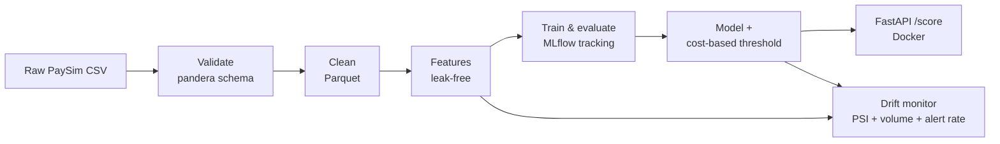
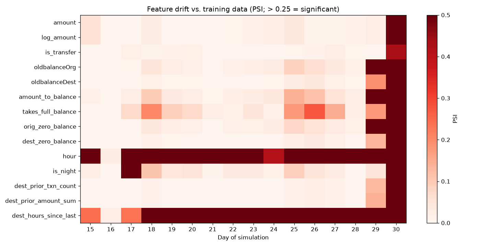

# Mobile Money Fraud Detection: an end-to-end ML system

[](https://github.com/Getrudetrudy01/mobile-money-fraud-detection/actions/workflows/ci.yml)

A production-style machine learning system that detects fraudulent mobile money transactions. It covers the whole lifecycle: validated data pipeline, leak-free feature engineering, model training with experiment tracking, a cost-based decision threshold, a real-time scoring API in Docker, drift monitoring, and CI.

I work in operations at a licensed payment service provider, so I built this the way I'd want a fraud system at work to behave. That means being honest about what the numbers really mean, choosing alert thresholds by business cost, and checking data health before blaming the model.

---

## Key findings

| | |
|---|---|
| **Best model** | LightGBM: test PR-AUC **0.9995**, catching 99.7% of fraud with zero false alarms at the cost-optimal threshold |
| **Why that number is too good** | One feature (`takes_full_balance`) provides **95%** of the model's gain. It mirrors how PaySim *generates* fraud, so the score is a ceiling, not a real-world estimate |
| **More realistic estimate** | Without that shortcut (ablation): PR-AUC **0.84**, catching **67%** of fraud at a 0.1% false-alarm rate |
| **Why PR-AUC, not ROC-AUC** | ROC-AUC stayed at **0.99** for both models. Only PR-AUC showed the real drop, so ROC-AUC is misleading for rare events |
| **Counting money vs. cases** | A one-line rule catches 97% of fraud *cases* but misses **~997M** in fraud *value*; LightGBM misses ~26M. The rule fails on exactly the largest frauds |
| **Monitoring** | The drift monitor detected a ~90% drop in transaction volume and recommended **investigating the data pipeline instead of retraining** |

---

## Architecture



Every stage is a script run with one command (`make data`, `make features`, `make train`, `make serve`, `make monitor`). Each stage reads from one data layer and writes to the next, and raw data is never modified.

---

## Data

[PaySim](https://www.kaggle.com/datasets/ealaxi/paysim1) is a synthetic dataset of **6.36M mobile money transactions** over 31 days (743 hours), simulated from real transaction logs of an African mobile money service (CC BY-SA 4.0).

What exploratory analysis showed ([`notebooks/01_eda.ipynb`](notebooks/01_eda.ipynb)):
- **Fraud is rare:** 0.129%. A model that always says "not fraud" would be 99.87% accurate, so accuracy is useless here.
- **Fraud only occurs in `TRANSFER` and `CASH_OUT`.** It's a two-step scheme: move the victim's money to a mule account, then cash it out. Modelling is restricted to these types (2.77M rows, 0.30% fraud).
- **The existing rule-based flag (`isFlaggedFraud`) catches almost nothing:** 16 of 8,213 frauds.
- **97.7% of frauds drain the sender's entire balance.**
- **Fraud rate peaks at 2–7 a.m.**, mainly because legitimate volume drops overnight while fraud continues.

---

## Pipeline and features

**Validation:** a [pandera](https://pandera.readthedocs.io/) schema checks types, ranges, allowed transaction types and ID formats. If upstream data changes shape, the pipeline stops loudly instead of training on bad data.

**Leakage prevention:** a real-time fraud model scores a transaction *before* approving it, so features may only use information available at that moment.
- ❌ Post-transaction balances (`newbalanceOrig`, `newbalanceDest`) are excluded from the realistic model, and the API doesn't even accept them.
- ✅ The "drains the account" signal is rebuilt from pre-transaction data: `amount / oldbalanceOrg`.
- ✅ Receiver-history features (`dest_prior_txn_count`, `dest_prior_amount_sum`, `dest_hours_since_last`) use **only earlier hours**. Transactions within the same hour have no reliable order, so they never count as each other's history. A unit test enforces this.

**Why receiver history and not sender history:** checking the data showed almost every sender appears only once (a PaySim limitation), but receivers repeat. Many incoming transfers to one account is also a classic mule-account signal.

---

## Modelling and evaluation

**Time-based split:** train on the earliest hours, validate on the next, test on the latest. A random split would let the model learn from the future.

| Split | Hours | Rows | Fraud rate |
|---|---|---|---|
| Train | 1–323 | 1.95M | 0.187% |
| Validation | 324–377 | 410k | 0.136% |
| Test | 378–743 | 408k | **0.983%** |

The test period has 5× more fraud because legitimate volume collapses late in the simulation. This is real distribution shift, and it means test and validation scores aren't directly comparable.

**Results on the test set:**

| Model | PR-AUC | ROC-AUC | Recall @ 0.1% FPR | Fraud value missed |
|---|---|---|---|---|
| Rule: flag if amount = full balance | 0.972 | 0.986 | 97.2% | ~997M |
| Logistic regression | 0.993 | 0.998 | 99.1% | ~67M |
| **LightGBM (realistic)** | **0.9995** | 0.9995 | **99.5%** | **~26M** |
| LightGBM (leaky: post-transaction balances) | 0.998 | 0.999 | 99.8% | ~0.4M |
| LightGBM (no drain features: ablation) | 0.845 | 0.990 | 67.4% | n/a |

**How I read these results:**
1. **The headline score reflects the simulator.** Feature importance shows `takes_full_balance` carries 95% of the gain. PaySim generates fraud by emptying accounts, and the model learned that rule.
2. **The ablation is the more honest number.** Without the drain features, the model still catches two-thirds of fraud at a strict false-alarm rate, using amount, balances, time of day and receiver history. Trees partly rebuild the drain signal from `amount` and `oldbalanceOrg`, which are its top features.
3. **The leakage experiment didn't show inflation here,** because realistic features already separate the classes almost perfectly. With leaky features, early stopping kept a single tree. On real data, the gap would be large.
4. **ROC-AUC hides problems on rare events:** 0.99 in both the full and the ablated model. PR-AUC showed the real difference.

All runs, parameters, metrics, feature importances and models are tracked in **MLflow** (`make mlflow-ui`).

---

## Choosing the alert threshold by cost

A model outputs probabilities, but operations needs a yes/no decision. The threshold is chosen by **business cost**, not by default (0.5):

- **Missed fraud** costs the transaction amount.
- **False alarm** costs a fixed amount for review time and customer friction (1,000 units, configurable).

The threshold is chosen on the validation set and reported once on the test set.

- **Realistic model:** threshold 0.34 → 99.7% of fraud caught, 0 false alarms.
- **Ablation model:** the threshold drops to the lowest value tested. Because a missed fraud averages ~1.5M, the cost model accepts roughly one false alarm per fraud caught (~240 alerts/day). **In practice I'd add an alert budget** matched to the review team's capacity.

---

## Real-time scoring API

FastAPI service with input validation (Pydantic), per-prediction explanations (LightGBM SHAP contributions) and a health check. The API **reuses the same feature functions as training** to prevent training-serving skew.

```bash
make serve          # or: make docker-build && make docker-run
```

```bash
curl -X POST localhost:8000/score -H "Content-Type: application/json" \
  -d '{"step": 3, "type": "TRANSFER", "amount": 500000, "oldbalanceOrg": 500000, "oldbalanceDest": 0}'
```

```json
{
  "fraud_probability": 1.0,
  "is_fraud": true,
  "threshold": 0.34,
  "model_version": "20261120-151850",
  "top_factors": [
    {"feature": "takes_full_balance", "contribution": 34.27},
    {"feature": "oldbalanceDest", "contribution": -1.07},
    {"feature": "dest_hours_since_last", "contribution": -0.19}
  ]
}
```

Interactive docs are at `/docs`. Invalid input (negative amounts, unsupported transaction types) is rejected with a `422` before reaching the model.

**Docker image:** `python:3.14-slim`, serving-only dependencies pinned to training versions, runs as a **non-root user**, with a built-in healthcheck.

---

## Monitoring

`make monitor` treats the test period as "production" and checks each day against recent known-good data:

- **Data drift:** Population Stability Index (PSI) per feature per day, implemented from scratch. Binary flags and missing values are handled explicitly.
- **Prediction drift:** the daily alert rate.
- **Data health:** daily volume against normal.



**What it found:** from day 17, transaction volume fell to 0–18% of normal and the alert rate rose from 0.13% to 0.98%. The model wasn't failing: its alerts tracked the real fraud rate. The legitimate traffic had disappeared.

**How the monitor evolved:**
- My first version recommended **retraining**.
- `day_of_week` flagged every day. That was a false alarm, because a single day can't match a 7-day distribution.
- `dest_hours_since_last` drifts structurally, because it grows over time.
- Most importantly, retraining on data with missing legitimate traffic would teach the model that most transactions are fraud.

The monitor now **checks data health before model health** and returns `INVESTIGATE_DATA_PIPELINE`.

---

## Engineering

- **21 tests** (pytest): validation rules, cleaning, leak-free history features, time split, metrics, cost threshold, API behaviour, PSI edge cases. API tests skip automatically when no trained model exists, so CI runs without the data.
- **CI** (GitHub Actions): Ruff linting and the full test suite on every push.
- **Configuration** in `configs/config.yaml`; no hard-coded paths or parameters.
- **Reproducible environment:** pinned requirements, plus a dev container for GitHub Codespaces.

```
├── configs/config.yaml        # all paths, parameters, costs, monitoring rules
├── notebooks/01_eda.ipynb     # exploratory analysis and findings
├── src/
│   ├── data/                  # schema + validation + cleaning
│   ├── features/              # leak-free feature engineering
│   ├── models/                # split, training, evaluation, cost threshold
│   ├── serving/               # FastAPI app + request/response schemas
│   └── monitoring/            # PSI drift + daily monitoring job
├── tests/                     # 21 unit and API tests
├── Dockerfile                 # serving image
├── Makefile                   # one command per pipeline stage
└── .github/workflows/ci.yml   # lint + tests on every push
```

---

## How to run

```bash
pip install -r requirements.txt
# Download PaySim from Kaggle into data/raw/ (requires a Kaggle API token)
kaggle datasets download -d ealaxi/paysim1 -p data/raw && unzip data/raw/paysim1.zip -d data/raw

make data        # validate + clean          -> data/clean/
make features    # leak-free features        -> data/features/
make train       # 5 models, MLflow logging  -> models/, reports/metrics.json
make mlflow-ui   # compare experiments at localhost:5000
make serve       # scoring API at localhost:8000/docs
make monitor     # drift report              -> reports/
make check       # lint + tests
```

---

## Limitations and future work

**Limitations**
- **Synthetic data.** PaySim's fraud is near-deterministic, so scores are far above what real systems achieve. The ablation result is the more realistic estimate.
- **Single-transaction senders.** Almost every sender appears once, so sender behaviour (velocity, typical amounts) can't be modelled.
- **Receiver history is passed in by the caller.** In production, it would come from a feature store updated in real time.
- **Overconfident probabilities.** The model outputs 1.0 for obvious fraud; it hasn't been calibrated.

**Future work**
- Probability calibration (Platt scaling or isotonic regression)
- An alert budget: choose the threshold under a daily review-capacity limit
- Rolling-window reference for structurally drifting features
- Load the approved model from the MLflow Model Registry at API startup instead of baking it into the image
- Test on a real or more realistic fraud dataset

---

## Author

**Getrude Makumator**: Computer Science graduate (UCC, 2024), working in payments operations and compliance at a Bank of Ghana-licensed payment service provider.

[LinkedIn](https://www.linkedin.com/in/getrude-makumator-g22) · getrudemawusimakumator@gmail.com

*Dataset: E. A. Lopez-Rojas, A. Elmir, S. Axelsson, "PaySim: A financial mobile money simulator for fraud detection," 28th European Modeling and Simulation Symposium (EMSS), 2016.*
